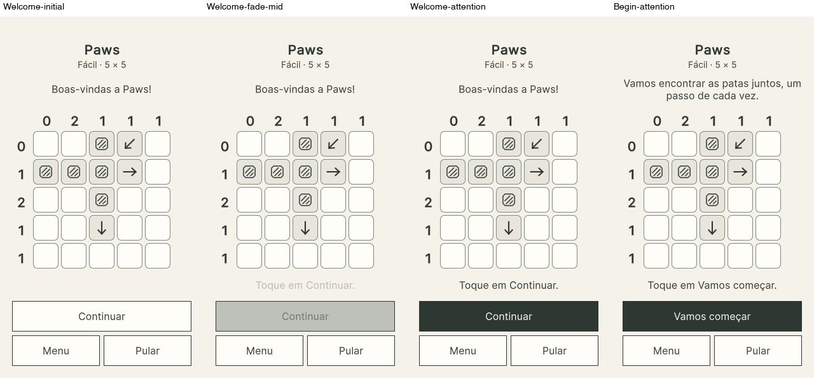

# Issue #95 — centered text and delayed advance guidance

Latest owner follow-up, recorded 2026-10-28. Runtime/test source:
`9697e3a70f0578f2822eccf1f632e264e860f165`. This supersedes the earlier immediate
Welcome emphasis, three-step helper policy and top-aligned instruction layout.
The existing implementation PR remains #97 targeting develop.

Every Continue/Let's start step starts with its normal, immediately clickable
button and invisible guidance. At two seconds, the shared Hint attention timer
and presenter apply the existing stable color inversion with a 200 ms native
fade; guidance fades in over the same interval. There is no forced wait or new
animation system. Hint retains its ordinary six-second interval and behavior.

The entire top instruction block is centered between the difficulty-label bottom
and the board's upper boundary, including its column-clue gutter. This keeps the
instruction out of the clue area. Bottom guidance is centered between the grid
bottom and the actual advance button. Board geometry, safe areas, 16-unit body
text and 48-unit minimum action targets are unchanged.

## Visual review

[Compact Portuguese — initial, mid-fade, attentive, Start](pt-BR-320-phases.png)

[Standard Spanish — Goal and Start before/after attention](es-390-phases.png)

| Logical viewport / safe top, bottom | EN | pt-BR | ES |
|---|---|---|---|
| 320×568 / 20, 0 | [All steps](en-320-all-steps.png) | [All steps](pt-BR-320-all-steps.png) | [All steps](es-320-all-steps.png) |
| 390×844 / 47, 34 | [All steps](en-390-all-steps.png) | [All steps](pt-BR-390-all-steps.png) | [All steps](es-390-all-steps.png) |
| 430×932 / 59, 34 | [All steps](en-430-all-steps.png) | [All steps](pt-BR-430-all-steps.png) | [All steps](es-430-all-steps.png) |

The all-step sheets show the attentive state for all nine informational stages;
all 22 stages are present in order. Original initial/attentive pairs for every
informational stage, intermediate fade and hold/release captures are indexed in
[screenshots.json](screenshots.json). Full originals and logs are retained under
ignored `.unity-results/issue95-attention/`.

## Actual validation

- Pinned Unity 6000.3.25f1 compilation passed; EditMode **683/683**, zero failed,
  skipped or inconclusive and successful editor exit. Python contracts **51/51**;
  repository and whitespace checks passed. Independent QA: **No blocking findings**.
- All nine real desktop-player walkthroughs exited zero: **198** distinct
  step/locale/size cases, **315** captures. All instructions and phase comparisons
  were visually inspected. No clipping, overlap, font shrinking or grid movement.
- Actual upper-block and lower-helper center errors are at most **0.5 logical
  units**, accounting for pixel rounding. Every captured grid rectangle exactly
  matches the previous revision at the same viewport/insets. Per-run bounds files
  retain the measured geometry and opacity observations.
- Mounted tests cover every early advance click, exact 1.999/2.000-second timing,
  per-step reset, localized Start guidance, shared fade configuration, and
  navigation/locale/focus/pause/Skip/replay/rebind/detach/disposal cleanup.
- All nine players observed actual intermediate native opacity, interrupted the
  fade via focus loss, verified immediate invisibility and no stale reappearance,
  then verified a fresh delay and complete fade after return. This real-player
  evidence supplements EditMode target/configuration tests: an earlier EditMode
  panel did not advance resolved opacity during a real-time wait. The failed run
  and this validation distinction are preserved in the [receipt](validation.json).
- Existing tap/drag, protection, mandatory 350 ms arrow hold, independent solve,
  completed lock, ordinary Hint and other regression coverage passed unchanged.

The only new copy is the action-specific Start helper: `Tap Let's start.` /
`Toque em Vamos começar.` / `Toca Empecemos.` Existing approved lesson copy,
controller order, fixture, rules, gestures, difficulty and monetization policy
are unchanged.

## Physical iPhone acceptance — owner task

The owner reported **pass** on 2026-10-28 for the supplied EN/pt-BR/ES presentation and cleanup checklist on this candidate. [Scoped owner report](owner-review-2026-10-28.json). At the owner's request,
source `321e82a` (validated runtime `9697e3a`) was built, signed with the existing
valid development profile, installed over the same review bundle without an
uninstall, and plainly launched on iPhone 17 / iOS 27.0.1 on 2026-10-28. Signature,
profile/device eligibility, matching symbols and running-process checks passed.
[Current technical preparation receipt](device-preparation.json). The earlier
[device preparation](../device-preparation.json) remains historical. Neither
installation proves physical acceptance; no physical interaction was automated.

The accepted checklist covered EN/pt-BR/ES text placement/readability, immediate
Continue/Start clicks, the two-second attention/fade, and cleanup on advance,
navigation, language changes and backgrounding. Existing automated hold and
independent-completion evidence remains separate; no broader physical coverage
is inferred. The owner explicitly authorized merging PR #97 into develop.
Production release remains unauthorized.
